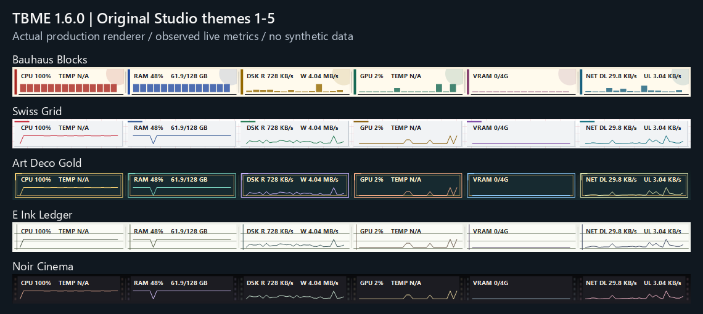
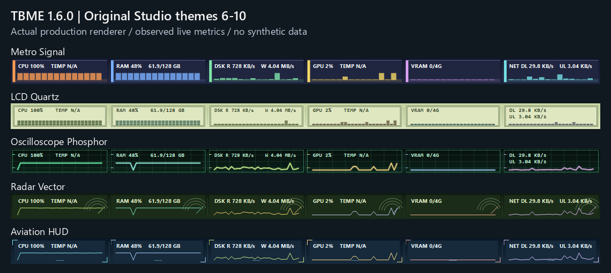
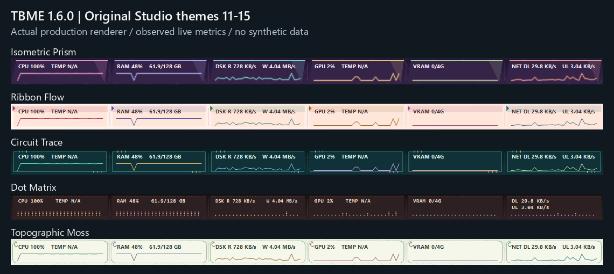
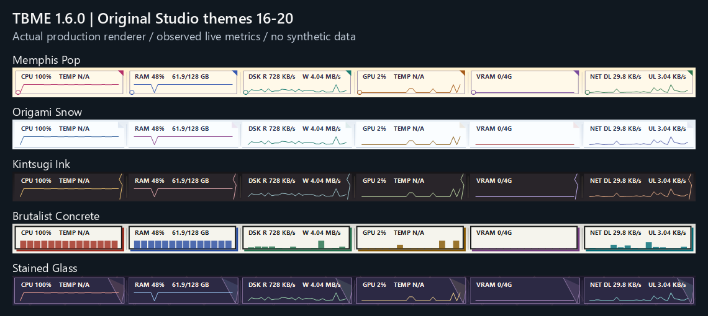

# Taskbar Monitor Enhanced

**Live Windows taskbar monitoring, an eight-page Performance Workspace, and 49 built-in themes.**

**Stable / Latest: [v1.7.1](https://github.com/GOD13emad/TaskbarMonitorEnhanced/releases/tag/v1.7.1)** — official Windows x64 Stable, **unsigned**. [Use the one installer and protected in-place updater](DOWNLOAD.md). Older [v1.7.0](https://github.com/GOD13emad/TaskbarMonitorEnhanced/releases/tag/v1.7.0) and [v1.6.0](https://github.com/GOD13emad/TaskbarMonitorEnhanced/releases/tag/v1.6.0) remain immutable.

Monitor CPU, RAM, disk, network, GPU, VRAM and available temperatures without putting privileged sensor collection inside the desktop UI. Version 1.6.0 adds 20 original Studio designs, local analysis, hardware inventory and practical alert controls.

## Performance Workspace

Right-click the taskbar monitor and choose **Performance workspace...** or **Theme Studio — 49 designs...**.

| Page | What it provides |
|---|---|
| Overview | Interactive session charts, selectable time windows, minimum/maximum/average/P95, CSV export, chart PNG and statistics JSON |
| Processes | Read-only process search/sort, normalized CPU, working/private memory, thread and handle counts, CSV export |
| Network | Adapter throughput and link utilization, selected-adapter accounting, monthly budget, optional 90-day local history, bit/s display |
| Storage | Mapped capacity/free space, read/write throughput and available temperature |
| Alerts | Sustained CPU/RAM/GPU/capacity thresholds, dwell time, cooldown, quiet hours, snooze and bounded event export |
| Themes | Search, favorites, light/dark filters, and the actual production renderer for previews |
| Profiles | Safe presentation import/export, presets and taskbar metric ordering |
| Hardware | Available CPU topology, RAM modules, GPU clocks/power/fans/PCIe and storage/network inventory; CSV/JSON export |

Use **Ctrl+1 through Ctrl+8** to switch workspace pages, **F5** to refresh, and **Esc** to close. The existing nine-page Settings window remains available for hardware selection, temperature thresholds, taskbar placement, diagnostics and startup behavior.

## Twenty original Studio themes

These are renderer-backed designs, not background images or palette-only recolors. An identical-palette/font/data test verifies twenty different geometry fingerprints.






The 28 original themes, twenty Studio themes and Glass Morphism are available as 49 renderer-backed choices. Contrast and compact rendering have dedicated regression tests.

## Data, privacy and reliability

Session history is capped at **3,600 samples**. Daily traffic history is capped at **90 days** and is **off on disk by default**. It records observed adapter counters, not ISP billing totals; first samples, counter resets and long collection gaps are excluded. One pinned adapter reduces VPN/physical double counting.

There is no project cloud telemetry or background monitoring upload. Process inspection is read-only. Presentation profiles cannot import startup registrations, sensor paths, notification permissions or traffic-retention settings. Exports are initiated by the user; process and hardware exports can contain local application and device names. See [Privacy](PRIVACY.md).

The non-elevated main UI retains process-isolated sensors, Explorer/taskbar recovery, continuous startup registration self-heal, adaptive battery polling, pause/resume, High Contrast and PerMonitorV2 configuration. Sensor availability is shown explicitly; unavailable values are not invented.

## One installation and in-place updates

**Exactly one installation per Windows user:** the official v1.7.1 Setup targets the canonical per-user LocalAppData TaskbarMonitorEnhanced root. Recognized public v1.6.0, v1.7 Preview1 and official v1.7.0 Stable installations update **in place**, without uninstalling, preserving settings, backup, sensor backend, Startup and Wallpaper. Close the running monitor normally before a manual update. Edited or unknown managed files are refused and running the exact same v1.7.1 Setup again is idempotent.

The current official **v1.7.1 is unsigned by owner decision**. Windows may show **Unknown publisher**. Verify SHA256 ABD106630F7BAB3471CAF3F5BD4313DFCF2D61DDE1DF79E72EFE91933C8F2F89 against the immutable official GitHub Release. Separately licensed protected PawnIO is not silently bundled.

## Installation and release integrity

Use the installer from the [official Releases page](https://github.com/GOD13emad/TaskbarMonitorEnhanced/releases). Each accepted release carries SHA-256 checksums, a release manifest, source archive, SPDX SBOM and acceptance evidence. [Download guidance](DOWNLOAD.md) records the current public release, not an unverified local build.

Automatic checks query the official GitHub Releases endpoint. Installer download/launch requires a user action and confirmation; the update path verifies canonical release identity, immutability and the exact SHA-256 immediately before launch.

**Public-trust Authenticode signing is not yet established.** SHA-256/provenance verification is not a substitute for a trusted publisher certificate. See the [Code signing policy](CODE_SIGNING.md).

## Build and verification

Requirements: x64 Windows, .NET Framework 4.8, Git and the SDK pinned in `global.json`. Pinned dependency identities are in `build/dependencies.lock.json`.

```powershell
./build/Build.ps1
./build/Verify-Determinism.ps1
./build/Test-Workspace.ps1 -Visual -OutputDirectory .local/proof-unique
./build/Test-Runtime.ps1 -Executable ./build/_out/App/TaskbarMonitorEnhanced.exe -OutputDirectory .local/runtime-unique
```

Use a new exact evidence directory for every test run; existing evidence is never silently replaced. Clean-clone determinism requires committed, clean source. Runtime tests require an interactive Windows desktop and the installed monitoring environment for hardware-dependent checks.

Tests cover schema migration, hardware errors, traffic resets, profile boundaries, all 49 themes, real taskbar Glass over ordinary foreground windows, Start/Settings native behavior and immutable-release integrity. Compilation alone does not constitute acceptance; linked hosted Windows receipts and SHA evidence are retained in Git history.

## Scope and compatibility

This release is a taskbar monitor and practical monitoring workspace, not a complete substitute for kernel handle/DLL inspection, every hardware sensor supported by specialist utilities, arbitrary executable plugins, overclocking or fan control. The [primary-source capability map](docs/project-control/R37_BENCHMARK.md) identifies implemented and deferred capabilities.

The validation host has one physical monitor. Deterministic taskbar selection is covered; physical two-monitor attachment is not claimed on that host. Protected sensor versions remain Broker **1.1.2+r21** and Supervisor **1.3.0+r33**.

## Authorship and license

**Lead Developer & Maintainer:** Dr. Ali-Akbar Emadeddin (`GOD13emad`).

Derived from `leandrosa81/taskbar-monitor` with GPL/upstream attribution preserved. Licensed under GNU GPL v3.0. See [License](LICENSE), [Authors](AUTHORS.md), [Attribution](COPYRIGHT_AND_ATTRIBUTION.md), [Third-party notices](THIRD_PARTY_NOTICES.md) and [AI-assisted development disclosure](AI_ASSISTED_DEVELOPMENT.md).
